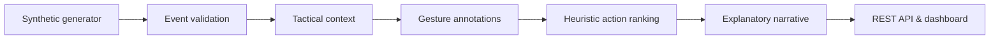

# BodyMap — Explainable Multimodal Football Intelligence

**Microsoft × Premier League "Inside the Game" Hackathon candidate / independently built prototype.**

BodyMap is a working web dashboard and deterministic Python backend that replays a completely synthetic football match, simulates body/head and face/hand labels, explains tactical context and displays heuristic next-action candidates. Three presentation profiles (Analyst, Broadcast, Fan), three languages (English, Serbian, Spanish), a five-stage auditable pipeline, live timeline, perspective/top-down pitch, exportable JSON, and automated tests are included.

## Run (Python 3.9+; no pip install)

```bash
python server/app.py --port 8080
```

Open **http://localhost:8080**. For tests:

```bash
python -m unittest discover -s tests -v
```

API: `GET /api/health`, `/api/match`, `/api/metrics?upto=30`, `/api/analyse?index=20&lang=en&audience=analyst`.

## Technical honesty / evaluation

- **Implemented:** deterministic fixture generation, 22 fictional players, 90 timeline events, geometry rendering in canvas with an angled pitch projection (not WebGL 3D), observable synthetic gesture labels, rule-based candidates, agent-like sequential processing stages, report export, test suite, GitHub Actions workflow.
- **NOT implemented:** real face/hand recognition from video, emotion detection, calibrated action prediction, AI model inference, Microsoft Foundry / Azure services, distributed orchestration, deployed cloud link, working 3D mesh engine. The five stages are deterministic functions, **not autonomous LLM agents**. Do not claim otherwise in submission.
- **No real player data**, real surveillance, copyrighted broadcast footage, or player identity recognition. Expression labels describe fabricated facial shapes, not mental states.

## Competition categories and evidence

1. **Technological implementation (20%)**: source, reproducible dataset, local zero-dependency run, tests, consistent endpoints.
2. **Agentic design / innovation (20%)**: transparent orchestration **prototype only**; real Microsoft Agent Framework implementation would be necessary to claim genuine agents.
3. **Real-world applicability (20%)**: analysts, broadcasters, fans; research concepts, no validated real-world efficacy.
4. **UX & presentation (20%)**: interactive pitch, toggled gestures, playback, audience selector, language selection, report export.
5. **Category adherence (20%)**: compare exact current official rules before selection; current prototype is not a compliant live cloud multi-agent submission.

## Architecture



## Repo organization

`web/` client, `server/` engine and HTTP API, `data/` 90 synthetic event fixture, `tests/` deterministic tests, `docs/` pitch, demo storyboard, criteria matrix, cloud upgrade blueprint.

## Responsible use

A simulated facial gesture is never evidence of nervousness, aggression, intention, deception, or health. Predictions are relative heuristic rankings without empirical calibration. For real-world use, require permission, consent and player/staff governance, dataset licensing, validation, and appropriate privacy review.

## Next steps before claiming production / prize readiness

Integrate actual Microsoft Foundry agents with telemetry and fallback; replace 2.5D canvas with optional Three.js WebGL model; publish verified running cloud demo; evaluate with held-out data; create under-two-minute screen recording; publish repository and complete submission. Do not embed API keys.

## 2026-10-28 rules-alignment upgrade
See `docs/RULES_AUDIT.md` for mandatory compliance evidence and gaps. Added validated synthetic-only input, replayable timed overlay schema (`/api/overlay`), differentiated audience-specific overlay text, end-of-match recap (`/api/recap`), auditable handoff state and testable fallback (`/api/analyse?fail=Gesture%20Intelligence`), and dedicated compliance tests. **No Microsoft AI model integration is represented as complete.**

## Microsoft Foundry integration (optional, real service calls)

An **opt-in real Microsoft Agent Framework / Foundry path** is included at `GET /api/ai`. Run `python -m pip install -r requirements-ai.txt`, deploy a Foundry model, authenticate with `az login`, and set `FOUNDRY_PROJECT_ENDPOINT` plus `FOUNDRY_MODEL`. See `docs/FOUNDRY_RUNBOOK.md`. **No live Azure invocation has been verified in this delivered package**, as the developer account/model are not connected. `/api/analyse` remains explicitly deterministic and usable offline. Tests of the agent boundary use injected fakes and are not proof of remote inference.

For GitHub: publish the *contents of this folder*, not the ZIP as the repository's only file. No `.env`, passwords or keys. Recommended public repository name: `bodymap-football-intelligence`.

## Public deployment (Render)

This repository includes `render.yaml` for a Render Blueprint and a `Dockerfile` for general container hosting. Follow [`docs/PUBLIC_DEPLOYMENT.md`](docs/PUBLIC_DEPLOYMENT.md). An authorized Render account and GitHub repository are required to obtain a real public URL. Do **not** confuse this deployment configuration with a live deployment.
